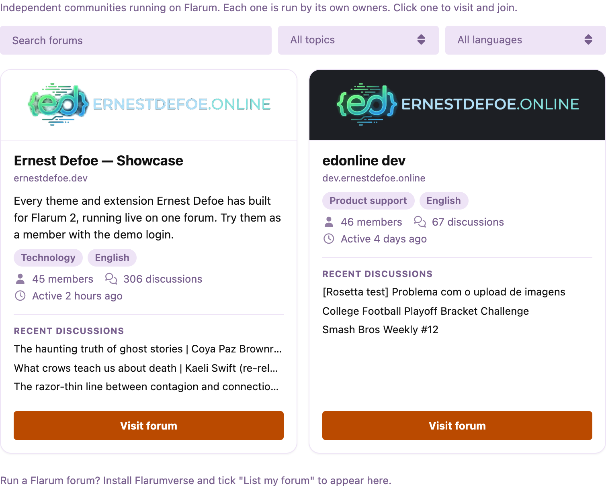
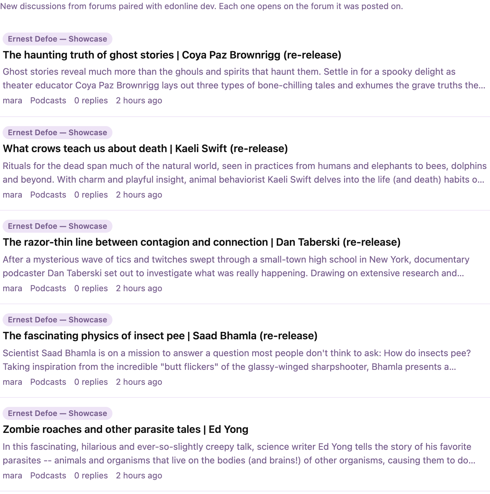

# Flarumverse

Flarum forums pair with each other and show each other's new discussions. Every link goes back to the forum it came from, so each forum sends and receives visitors. There's no central server: forums talk to each other directly.

- **Pair with a forum:** enter its address in the admin page. The other forum approves, and from then on each shows the other's newest discussions on a **Flarumverse** page (`/flarumverse`).
- **Only public discussions are shared:** the ones a guest could read. Never private, hidden or restricted ones. Each shares its title, first few lines, author, tag and reply count.
- **Always current:** Flarumverse refreshes every partner every 15 minutes through Flarum's scheduler, so edits and deletions follow. With a queue worker running, new discussions arrive within seconds.
- **The directory:** tick "List my forum" to appear on [ernestdefoe.online/forums](https://ernestdefoe.online/forums), where people looking for a community browse Flarum forums by topic and language. Opt-in, approved by hand, and you can leave at any time.





## Install

```sh
composer require ernestdefoe/flarumverse
php flarum migrate
php flarum cache:clear
```

Then enable **Flarumverse** in the admin panel. Your forum must be served over **https**, and Flarum's scheduler should be running (`php flarum schedule:run` every minute from cron).

## Update

```sh
composer update ernestdefoe/flarumverse
php flarum migrate
php flarum cache:clear
```

## How forums talk

Each forum has an Ed25519 key pair (the private key is encrypted at rest). Requests between forums go to `/.well-known/flarumverse` and are signed over the method, the exact address, the sender, the time and the body. A signature is accepted once and only within five minutes. Outbound requests only go to public https addresses, never follow redirects, and are size- and time-capped.

## Support

[Issues](https://github.com/ernestdefoe/flarumverse/issues) · [Support forum](https://ernestdefoe.online)

☕ If you like the things I have built, consider [buying me a coffee](https://buymeacoffee.com/ernestdefoe).

MIT licensed.
